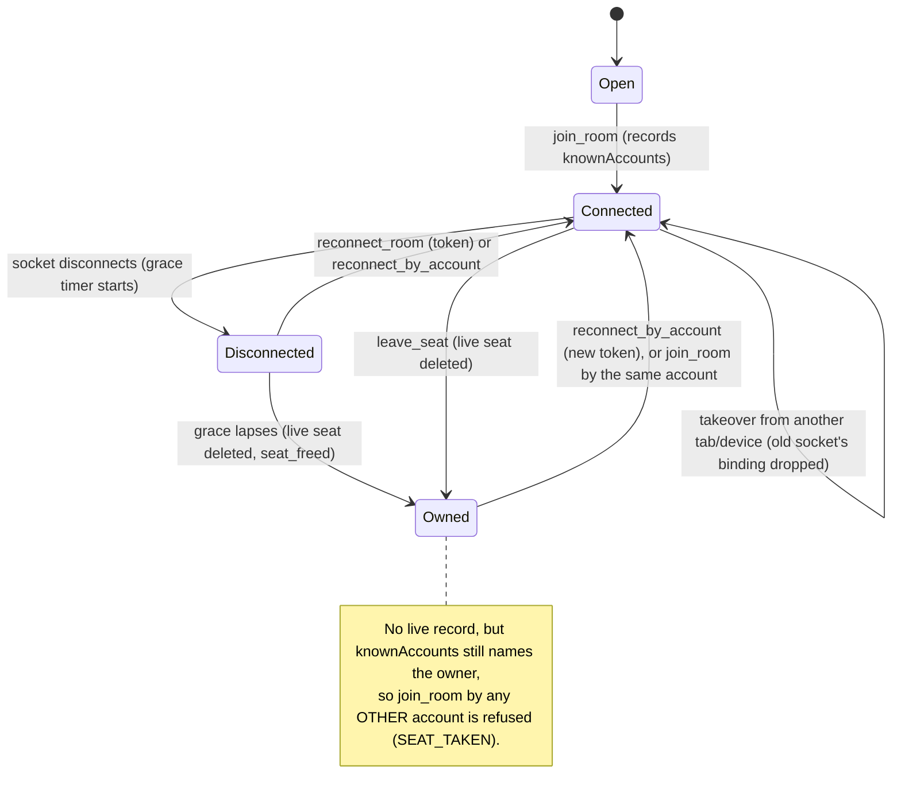

# Rooms, seats, and identity

How a player holds, loses, and regains a seat, and how long a room
lives. This is the trickiest part of the platform. The code is spread
across `packages/platform/src/rooms/` (`roomMembership.ts`,
`roomCore.ts`, `roomIdleSweep.ts`, `roomNotifications.ts`,
`roomBroadcast.ts`), and those files carry the detailed "why" comments.
This page is the map.

Every socket is signed in: the Socket.IO auth middleware in
`packages/server/src/index.ts` sets `socket.data.email` from the session,
and that server-verified email (the *account*) is the only identity the
platform trusts. Names and notification emails are client-supplied
preferences, not identity.

## The records a room keeps

| Record | Keyed by | Lifetime | What it's for |
|---|---|---|---|
| `seats[seat]` (live seat: `seatToken`, `socketId`, `disconnectedAt`, `name`, `email`) | seat | Created on join; **deleted** when the reconnect grace (2 min) lapses or the player leaves | Who is connected *right now*; the seat token |
| `socketBindings` (in memory only, not persisted) | socket id | Until disconnect, leave, or takeover by another socket | Which room+seat a socket may act as. `applyAction` trusts only this, never client data |
| `knownAccounts[seat]` | seat | **Never cleared** | Who owns the seat. Blocks other accounts from joining it; powers reclaiming by account and the "your games" list |
| `knownEmails[seat]` | seat | Never cleared | Where turn and game-over emails go (opt-in at join) |
| `knownNames[seat]` | seat | Never cleared | Name shown when no live seat exists (lobby, "your games") |
| `recapViewedBy[account]` | account | Never cleared | Whether each owner has seen a finished game's result |
| `spectatorSocketIds` | — | In memory only | Spectators hold no durable claim |

The key split is that **live seat ≠ ownership**. A seat's live record
comes and goes with connections, but `knownAccounts` makes ownership
permanent. `RoomInfo.seats[seat]` reports both separately: `claimed`
comes from `knownAccounts` and `connected` from the live record.

## One seat's lifecycle

`Open` is the only state in which a *different* account can take the
seat. Note that `leave_seat` does not release ownership either: it only
removes the live record.

After a server restart (or the first touch of a room not yet in the
memory cache), a room is loaded from the database with every persisted
live seat marked `Disconnected` and its grace timer running.

## The three ways into a seat

All in `roomMembership.ts`. Each is a socket event handled in
`packages/platform/src/socket/roomHandlers.ts`.

1. **`join_room`**: claims a seat that has no live record. Refused if
   the seat is live (`SEAT_TAKEN`, or `SEAT_RECONNECTING` within the
   grace window) or owned by a different account. Issues a new seat token
   and records `knownAccounts`.
2. **`reconnect_room`**: presents a stored seat token for a seat whose
   live record still exists, and takes it over even if another socket
   currently holds it. It fills in `knownAccounts` only if the seat had
   none, and never reassigns an existing owner.
3. **`reconnect_by_account`**: finds the seat whose `knownAccounts`
   entry is this account. It takes over the live seat if there is one,
   otherwise recreates the live seat with a new token.

On a takeover (2 or 3 onto a live seat), the previous socket's binding is
dropped, so an old tab can neither act nor `leave_seat` the new holder
out. It also receives `seat_taken_over`.

The client (`packages/client/src/state/useRoomConnection.ts`) tries
these in order:
- reconnect link params (only in emails sent before 2026-11-17)
- the token stored in localStorage for this room
- reconnecting by account
- the seat picker, as a last resort

Turn-notification emails now link to the bare room URL and rely on
reconnecting by account.

## How long a room lives

The idle sweep (`roomIdleSweep.ts`, every minute) deletes a room only
when **all** of these hold:

- no spectator is connected;
- it isn't *permanently exempt*: a room that is unfinished and has ever
  been claimed (any `knownAccounts` or `knownEmails` entry) is never
  swept and can only be deleted by an explicit abandon;
- it has been idle longer than its timeout: **30 minutes** for a room
  nobody ever claimed, **7 days** for a finished room;
- if finished, every owning account has viewed the recap.

| Room | Swept? |
|---|---|
| Never claimed | After 30 min idle |
| Claimed, unfinished | Never (only via abandon) |
| Finished, some owner hasn't seen the result | Never, until they have |
| Finished, everyone has seen it | After 7 days idle |

Abandoning (`abandonRoom`, offered on the "your games" list for
unfinished rooms) requires the caller to own at least one seat, and no
seat outside the caller's own may ever have been claimed by another
account.

The sweep walks only rooms in the in-memory cache. A room that exists
only in the database (not touched since the last restart) isn't
considered until something loads it.

## Writes

Every room change is saved to the repository as a full snapshot. Saves
and deletes for one room go through a per-room queue (`enqueueWrite` in
`roomCore.ts`), so they reach the database in the order they were
issued.
